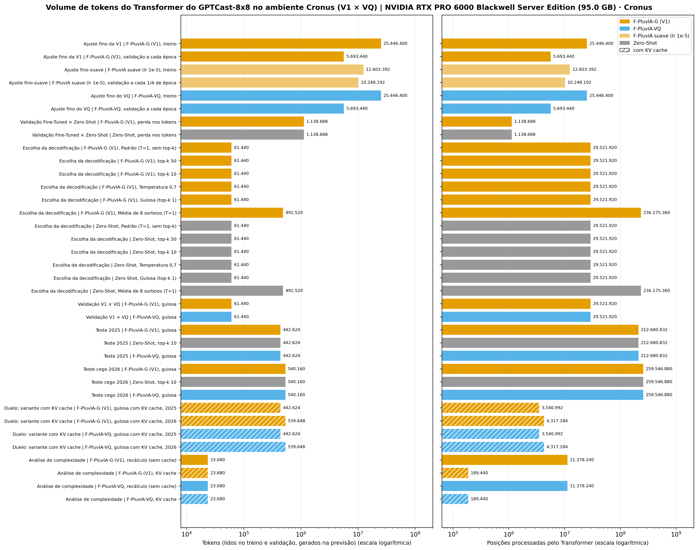
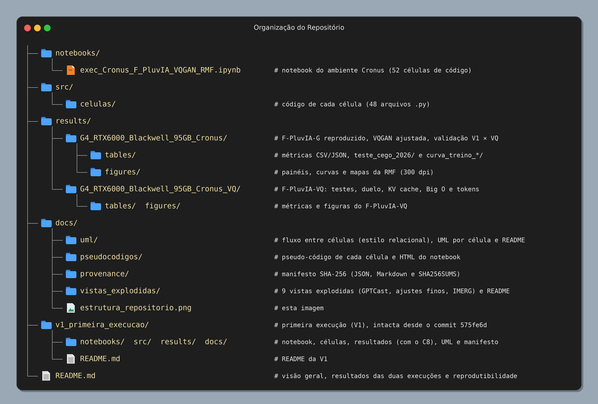

# ⛈️ F-PluvIA Metropolitan: Nowcasting de Precipitação na Região Metropolitana de Fortaleza via Adaptação de Domínio Cross-Sensor do GPTCast-8x8

[](https://ifce.edu.br/maracanau)
[-3776AB?style=flat-square&logo=python&logoColor=white)](https://www.python.org/)
[](https://pytorch.org/)
[](https://gpm.nasa.gov/data/imerg)
[](#-custo-computacional)
[](docs/provenance/)

> **Trabalho de Conclusão de Curso (TCC)**, no formato de artigo científico — Bacharelado em Ciência da Computação (2026.2)
> **Instituto Federal de Educação, Ciência e Tecnologia do Ceará (IFCE) — Campus Maracanaú**
> **Autor:** Raul Santiago Pinheiro ([Lattes](https://lattes.cnpq.br/8378024959016497)) · **Orientador:** Amauri Holanda de Souza Júnior ([Lattes](http://lattes.cnpq.br/2629504708221802) · [ORCID](https://orcid.org/0000-0002-2912-0781))

---

## 📌 Visão Geral

O **F-PluvIA Metropolitan** avalia se um modelo generativo de *nowcasting* de precipitação (previsão de +30 a +120 minutos), treinado originalmente com radar meteorológico, pode ser adaptado para estimativas de satélite nos **19 municípios da Região Metropolitana de Fortaleza (RMF)**.

O ponto de partida é o **GPTCast-8x8** (Franch et al., 2025), treinado pela Fondazione Bruno Kessler com dados de radar do norte da Itália. Este trabalho ajusta o modelo ao produto de satélite **NASA/JAXA GPM IMERG v7**, reamostrado para uma malha de **2 km** (128 × 128 pixels) sobre a RMF, e o compara com métodos de extrapolação da biblioteca `pysteps` (LINDA e fluxo óptico Lucas-Kanade) e com a persistência.

Foram avaliadas duas versões do modelo ajustado:

| Modelo | O que é ajustado | Papel |
| :--- | :--- | :--- |
| **F-PluvIA-G** | Só o Transformer, com a VQGAN congelada (decodificação gulosa) | Modelo do teste cego de 2026 |
| **F-PluvIA-VQ** | Também o codificador e o decodificador da VQGAN, com o *codebook* fixo; o Transformer é ajustado de novo sobre os novos *tokens* | Variante que venceu o F-PluvIA-G pela regra fixada antes do teste |

### Duas execuções, um repositório

Este é o **repositório oficial** do TCC. Ele reúne as duas execuções do trabalho, cada uma com notebook, resultados, diagramas e manifesto SHA-256 próprios:

| Execução | Onde está | Notebook | Modelos avaliados |
| :--- | :--- | :--- | :--- |
| **Cronus** (versão final) | raiz do repositório | [`notebooks/exec_Cronus_F_PluvIA_VQGAN_RMF.ipynb`](notebooks/exec_Cronus_F_PluvIA_VQGAN_RMF.ipynb) | F-PluvIA-G (reproduzido), **F-PluvIA-VQ**, Zero-Shot |
| **Primeira execução (V1)** | [`v1_primeira_execucao/`](v1_primeira_execucao/) | [`v1_primeira_execucao/notebooks/`](v1_primeira_execucao/notebooks/) | F-PluvIA-G, F-PluvIA-C8, F-PluvIA-A, Zero-Shot |

- **V1:** ajusta só o Transformer, com a VQGAN congelada. Foi mesclada a este repositório com o histórico de *commits* preservado; o repositório onde nasceu está hoje privado e arquivado. Tem o seu próprio [README](v1_primeira_execucao/README.md).
- **Cronus:** *fork* isolado da V1, com pasta própria no Google Drive, criado para ajustar também a VQGAN (F-PluvIA-VQ). Para que a comparação fosse justa, o F-PluvIA-G foi **treinado de novo do zero** no Cronus, com a mesma receita; a reprodução bateu com a V1 (CSI ≥ 0,5 mm/h em 2025: 0,4225 contra 0,422).

**Do artigo ao repositório**

| Seção do artigo | Execução | Onde estão os dados |
| :--- | :--- | :--- |
| 4.1 Ajuste fino · 4.2 Teto da VQGAN e decodificação | V1 | [`v1_primeira_execucao/results/G4_RTX6000_Blackwell_95GB/`](v1_primeira_execucao/results/G4_RTX6000_Blackwell_95GB/) |
| 4.3 Testes de 2025 e 2026 · 4.4 Alertas por município · 4.5 Custo | V1 (F-PluvIA-G, F-PluvIA-C8, Zero-Shot) | [`v1_primeira_execucao/results/G4_RTX6000_Blackwell_95GB/`](v1_primeira_execucao/results/G4_RTX6000_Blackwell_95GB/) |
| 4.6 Variante com a VQGAN ajustada (F-PluvIA-VQ) · duelo G × VQ · KV *cache* | Cronus | [`results/G4_RTX6000_Blackwell_95GB_Cronus/`](results/G4_RTX6000_Blackwell_95GB_Cronus/) e [`results/G4_RTX6000_Blackwell_95GB_Cronus_VQ/`](results/G4_RTX6000_Blackwell_95GB_Cronus_VQ/) |

---

## 🏗️ Arquitetura e Ajuste Fino

O modelo tem **395,64 milhões de parâmetros** em dois estágios:

1. **Estágio 1 — VQGAN (90,71 M parâmetros, 22,93 %):** codifica cada quadro de 128 × 128 pixels em 8 × 8 = 64 *tokens*, cada um o índice de um dos 1.024 vetores do *codebook* (um bloco de 16 × 16 pixels, ≈ 32 km).
   - **Congelada no F-PluvIA-G.** O teto de reconstrução (codificar e decodificar quadros observados de 2024, sem previsão) acerta o lugar da chuva (CSI 0,85 a 0,5 mm/h), mas com a textura do radar de origem: volume 17 % acima do observado e núcleos mais concentrados (S ≈ −0,31 no SAL).
   - **Ajustada no F-PluvIA-VQ** (Célula 4.6), com o *codebook* fixo: perda MWAE (peso 10) + LPIPS (0,1) + a mesma MWAE para cada quadro decodificado isoladamente + termo de quantização, sem o discriminador; `float32`, taxa 1 × 10⁻⁵. A perda de validação de 2024 caiu **42 %** (0,1525 → 0,0885), e só 6,7 % dos *tokens* continuaram iguais aos da VQGAN original.

2. **Estágio 2 — Transformer com arquitetura GPT-2 (304,93 M parâmetros, 77,07 %, ajustado):** prevê o próximo *token* a partir dos anteriores, com contexto máximo de 512 *tokens* (8 quadros × 64). Os pesos vêm do *checkpoint* do GPTCast; nenhum peso da OpenAI é usado.
   - **Previsão:** recebe 7 quadros (3,5 horas) e gera os 4 horizontes (+30, +60, +90 e +120 min), um *token* por vez.
   - **Tokenização empilhada:** os 8 quadros entram na VQGAN como uma única imagem, como no treino original e na previsão do GPTCast.

**Ajuste fino do Transformer** (GPU NVIDIA RTX PRO 6000 Blackwell, 95 GB): taxa de aprendizado 5 × 10⁻⁵, lote 16, precisão `bf16-mixed`, até 15 épocas, parada antecipada pela perda de validação de 2024.

| Medida (validação 2024, 2.224 janelas) | Zero-Shot | F-PluvIA-G |
| :--- | :---: | :---: |
| Entropia cruzada (nats/*token*) | 5,1779 | **4,7155** |
| Perplexidade | 177,3 | **111,7** (−37,0 %) |

- O melhor *checkpoint* veio da **primeira época**; depois dela, a perda de validação subiu (sobreajuste). Uma taxa cinco vezes menor (1 × 10⁻⁵, validação a cada ¼ de época) chegou ao mesmo patamar e não foi adotada.
- A perda de validação do F-PluvIA-VQ (4,8038) **não é comparável** com a do F-PluvIA-G, porque os *tokens*-alvo são outros. A comparação justa é feita nas previsões em mm/h.

### Decodificação

O mesmo modelo ajustado gera previsões diferentes conforme a forma de escolher cada *token*. As estratégias foram comparadas **na validação de 2024**, antes de qualquer teste:

| Produto | Decodificação | Uso |
| :--- | :--- | :--- |
| **F-PluvIA-G** | Gulosa (*top-k* 1) | Produto principal com a VQGAN congelada |
| **F-PluvIA-VQ** | Gulosa (*top-k* 1) | Variante com a VQGAN ajustada |
| F-PluvIA-C8 | Média de 8 sorteios | Conjunto de alta detecção (só na V1) |
| F-PluvIA-A | Sorteio padrão do pacote (T = 1) | Referência; o pior no teste de 2025 (só na V1) |
| Zero-Shot | *Top-k* 10 | Modelo original, sem ajuste fino |

---

## 🛰️ Dados

| Parâmetro | Especificação |
| :--- | :--- |
| **Treino, validação e teste** | NASA GPM IMERG **Final Run** v7 (IMERG-FR, calibrado com pluviômetros) |
| **Teste cego 2026** | NASA GPM IMERG **Late Run** v7 (IMERG-LR, tempo quase real) |
| **Período** | Quadra chuvosa do Ceará (fev–mai) de 2019 a 2025: **28 meses** |
| **Malha** | 128 × 128 pixels a 2 km (256 × 256 km), por interpolação bicúbica. A resolução efetiva continua a do IMERG (≈ 10 km) |
| **Conversão** | Chuva limitada a [0, 205] mm/h e convertida para [0, 60] dBZ por Marshall-Palmer (`Z = 200·R^1,6`) |
| **Janelas** | **13.893** sequências de **11 quadros** (passo de 30 min, uma janela a cada 60 min), só com chuva |

**Divisão cronológica estrita** (sem sobreposição entre anos):

| Partição | Período | Janelas | Proporção | Papel |
| :--- | :---: | :---: | :---: | :--- |
| **Treino** | 2019–2023 | 9.940 | 71,5 % | Ajuste fino (recorte aleatório de 8 dos 11 quadros) |
| **Validação** | 2024 | 2.224 | 16,0 % | Parada antecipada e escolha da decodificação |
| **Teste** | 2025 | 1.729 | 12,4 % | Avaliação independente; decide o duelo G × VQ |
| **Teste cego** | 2026 (IMERG-LR) | 2.108 | — | Ano e produto nunca vistos pelo F-PluvIA-G |

---

## 📊 Principais Resultados

Valores do ambiente Cronus, nas mesmas janelas, na média dos horizontes de +30 a +120 min; a linha marcada com † vem da V1, que tem as mesmas janelas e as mesmas referências (LINDA, Lucas-Kanade e persistência). Os intervalos de confiança (IC) são de 95 %, por *bootstrap* pareado em blocos de dias inteiros. Os valores da V1 para todos os métodos estão no [README da V1](v1_primeira_execucao/README.md).

### Por pixel

| Método | CSI ≥ 1 mm/h 2025 | CSI ≥ 1 mm/h 2026 | MAE 2025 [mm/h] | MAE 2026 [mm/h] | Volume previsto/observado 2025 | Volume 2026 |
| :--- | :---: | :---: | :---: | :---: | :---: | :---: |
| **F-PluvIA-VQ** | 0,462 | 0,413 | 0,332 | 0,321 | 0,883 | 0,914 |
| **F-PluvIA-G** | 0,399 | 0,361 | 0,450 | 0,415 | 1,059 | 1,091 |
| F-PluvIA-C8 † | 0,338 | 0,301 | 0,510 | 0,467 | 1,239 | 1,253 |
| Zero-Shot (*top-k* 10) | 0,420 | 0,366 | 0,814 | 0,634 | 2,079 | 1,760 |
| LINDA (`pysteps`) | **0,487** | **0,418** | 0,330 | 0,332 | 1,020 | 1,048 |
| Lucas-Kanade (`pysteps`) | 0,475 | 0,414 | **0,312** | **0,310** | 0,890 | 0,919 |
| Persistência | 0,426 | 0,385 | 0,373 | 0,347 | **1,001** | **1,004** |

### Alertas por município (F1 em %)

| Método | Atenção ≥ 0,5 mm/h 2025 | Atenção 2026 | Alerta ≥ 1 mm/h 2025 | Alerta 2026 | Severo ≥ 5 mm/h 2025 | Severo 2026 |
| :--- | :---: | :---: | :---: | :---: | :---: | :---: |
| **F-PluvIA-VQ** | 72,3 | **64,8** | 70,5 | **59,8** | 57,6 | **42,5** |
| **F-PluvIA-G** | 70,2 | 63,8 | 68,0 | 58,7 | 50,2 | 35,0 |
| F-PluvIA-C8 † | 59,2 | 55,0 | 59,9 | 51,3 | 53,6 | 35,9 |
| Zero-Shot (*top-k* 10) | 70,4 | 63,0 | 67,4 | 56,9 | 40,9 | 27,7 |
| LINDA | 72,4 | 64,1 | **71,0** | 59,3 | **60,7** | 38,9 |
| Lucas-Kanade | **72,7** | 64,3 | 70,5 | 58,8 | 58,8 | 40,4 |
| Persistência | 66,3 | 60,5 | 64,0 | 54,1 | 49,9 | 35,9 |

### Duelo F-PluvIA-G × F-PluvIA-VQ (Célula 13.7)

A regra foi fixada antes do teste: o F-PluvIA-VQ só substituiria o F-PluvIA-G se o IC 95 % do ganho de F1 em Atenção, **em 2025**, ficasse todo acima de zero.

| Diferença VQ − G | 2025 | 2026 |
| :--- | :---: | :---: |
| F1 Atenção (pontos) | **+2,1** (+1,3 a +3,0) | +1,0 (+0,2 a +1,7) |
| F1 Alerta (pontos) | +2,6 (+1,5 a +3,7) | +1,1 (+0,3 a +2,0) |
| F1 Severo (pontos) | +7,4 (+3,8 a +11,4) | +7,5 (+3,2 a +10,5) |
| CSI ≥ 0,5 mm/h | +0,057 (+0,047 a +0,066) | +0,047 (+0,038 a +0,055) |

Resultado: **o F-PluvIA-VQ venceu**. O ano de 2026 não é cego para ele, porque a VQGAN foi ajustada depois do teste cego do F-PluvIA-G.

### Leitura dos resultados

- **O ajuste fino do Transformer calibra a intensidade.** O F-PluvIA-G mantém o volume de chuva próximo do observado (razão de 1,06 a 1,09), enquanto o Zero-Shot superestima em 76 % a 108 %. A perda nos *tokens* caiu em todas as 2.224 janelas de validação.
- **Com a VQGAN congelada, os métodos clássicos ganham por pixel.** A persistência e a extrapolação superam o F-PluvIA-G no CSI por pixel nos dois anos. Na escala municipal, o F-PluvIA-G supera a persistência em Atenção e Alerta, com significância, nos dois anos.
- **Ajustar a VQGAN tira a maior parte do viés de textura.** O F-PluvIA-VQ supera a persistência e o Zero-Shot nos três níveis de alerta nos dois anos e empata com o LINDA e o Lucas-Kanade (no Alerta de 2026, supera o Lucas-Kanade). O S do SAL passa de −0,41/−0,44 para −0,04/−0,23.
- **O F-PluvIA-C8 (V1) detecta mais, mas erra mais.** A média de 8 sorteios teve o maior POD em 2025, com alarmes falsos de até 65 % e o menor F1 em Atenção e Alerta nos dois anos; a vantagem no Severo de 2025 não se repetiu em 2026.
- **Por pixel, a distância para a extrapolação quase fecha.** Em 2025, o F-PluvIA-VQ empata com a persistência no CSI, com MAE menor, e ainda fica abaixo do LINDA; em 2026, supera a persistência no CSI ≥ 1 mm/h e empata com a extrapolação.

---

## 💻 Custo Computacional

Medido na GPU NVIDIA RTX PRO 6000 Blackwell (95 GB) do Google Colab Pro+:

| Etapa | Tempo |
| :--- | :--- |
| Ajuste fino do Transformer (F-PluvIA-G, 5 épocas) | 16,8 min (202 s por época) |
| Ajuste fino da VQGAN (F-PluvIA-VQ, 10 épocas) | 150,6 min |
| Ajuste fino do Transformer sobre os novos *tokens* (F-PluvIA-VQ) | 17,0 min |
| Previsão de uma janela (4 horizontes), F-PluvIA-G ou F-PluvIA-VQ | 1,63 s |
| A mesma previsão com KV *cache* | 1,44 a 1,45 s (1,12× a 1,13×) |
| Previsão de uma janela, LINDA / Lucas-Kanade (CPU) | 0,76 s / 0,03 s |

A previsão é autorregressiva: cada quadro exige **64 passadas** do Transformer, uma por *token*, sobre contextos de 449 a 512 *tokens* (30.752 posições por quadro). Com KV *cache* (Células 13.7 e 13.7.1), o contexto passa uma vez e cada *token* novo processa uma posição (512 por quadro, 60× menos). O ganho em tempo é só de 1,13×: com lote 1, cada passada é dominada por custos fixos, e não pelas contas. Em `float32`, as duas implementações escolheram os mesmos *tokens*, e as métricas não mudaram.

### 🔢 Volume de *tokens* (Célula 13.7.2)

Aqui um *token* é um bloco de 16 × 16 pixels da imagem de chuva (um índice do *codebook* da VQGAN), e não um pedaço de texto. A contagem cobre tudo o que rodou no Cronus, do ajuste fino ao duelo:

| | *Tokens* | Posições processadas pelo Transformer |
| :--- | :---: | :---: |
| Lidos no treino e na validação | 87,4 milhões | 87,4 milhões |
| Gerados nas previsões | 6,7 milhões | **2,28 bilhões** |
| **Total** | **94,1 milhões** | **2,37 bilhões** |

- **Um quadro de +30 min** custa 64 *tokens* gerados: 30.752 posições em 0,41 s sem *cache* (~157 *tokens*/s) ou 512 posições em 0,36 s com KV *cache* (~177 *tokens*/s).
- As previsões com KV *cache* do duelo geraram 2,0 milhões de *tokens* processando 16,1 milhões de posições; sem o *cache*, seriam 967 milhões.
- O ajuste da VQGAN (Célula 4.6) não passa pelo Transformer e fica fora da conta.
- Na V1, que incluiu o F-PluvIA-C8 nos dois testes, o total foi de 91,7 milhões de *tokens* e 5,99 bilhões de posições; o C8 respondeu por cerca de dois terços dos *tokens* gerados ([detalhes no README da V1](v1_primeira_execucao/README.md)).



---

## 📂 Estrutura do Repositório

```

## 📂 Estrutura do Repositório



```text
F-PluvIA-Metropolitan-TCC-GPTCast-IFCE-Maracanau/
├── notebooks/
│   └── exec_Cronus_F_PluvIA_VQGAN_RMF.ipynb     # notebook do ambiente Cronus (52 células de código)
├── src/
│   └── celulas/                                 # código de cada célula do notebook (um .py por célula)
├── results/
│   ├── G4_RTX6000_Blackwell_95GB_Cronus/        # F-PluvIA-G reproduzido, ajuste da VQGAN e validação V1 × VQ (2024)
│   │   ├── tables/                              # métricas em CSV/JSON
│   │   │   ├── teste_cego_2026/                 # série fev–mai/2026 e alertas por município
│   │   │   └── curva_treino_*/                  # logs do ajuste fino (metrics.csv), inclusive o do F-PluvIA-VQ
│   │   └── figures/                             # painéis, curvas e mapas da RMF a 300 dpi
│   └── G4_RTX6000_Blackwell_95GB_Cronus_VQ/     # F-PluvIA-VQ: testes, duelo, KV cache, Big O e volume de tokens
│       ├── tables/
│       └── figures/
├── docs/
│   ├── uml/                                     # diagramas UML de cada célula e do fluxo entre células
│   ├── pseudocodigos/                           # pseudo-código de cada célula e versão HTML do notebook
│   ├── provenance/                              # manifesto SHA-256 (JSON, Markdown e SHA256SUMS)
│   └── estrutura_repositorio.png                # imagem da organização do repositório
├── v1_primeira_execucao/                        # primeira execução, com histórico e estrutura próprios
│   ├── notebooks/                               # notebook da V1
│   ├── src/celulas/                             # código das células da V1
│   ├── results/G4_RTX6000_Blackwell_95GB/       # resultados da V1 (inclui o F-PluvIA-C8)
│   ├── docs/                                    # UML, pseudo-códigos e manifesto SHA-256 da V1
│   └── README.md                                # README da V1, mantido como estava
└── README.md
```

As pastas `src/celulas/`, `docs/uml/`, `docs/pseudocodigos/` e `docs/provenance/` da raiz são regravadas pela célula de Deploy do Cronus a cada execução. A pasta `v1_primeira_execucao/` fica fora desse alcance e é mantida exatamente como estava no último *commit* da V1 (`575fe6d`).

```

As pastas `src/celulas/`, `docs/uml/`, `docs/pseudocodigos/` e `docs/provenance/` da raiz são regravadas pela célula de Deploy do Cronus a cada execução. A pasta `v1_primeira_execucao/` fica fora desse alcance e é mantida exatamente como estava no último *commit* da V1 (`575fe6d`).

---

## 🔁 Reprodutibilidade

- **Ambiente:** Google Colab Pro+ com GPU, PyTorch 2.14.1, pySTEPS 1.21.5 e gpm-api 0.4.0. O identificador `ENV_TAG` separa *checkpoints* e resultados por ambiente: `G4_RTX6000_Blackwell_95GB_Cronus` para o F-PluvIA-G e `G4_RTX6000_Blackwell_95GB_Cronus_VQ` depois da troca para o F-PluvIA-VQ (Célula 13.6).
- **Credenciais:** pelos Segredos do Colab, nunca no código. `PPS_USERNAME` para baixar o IMERG da NASA PPS; `GITHUB_TOKEN` só para a célula de Deploy.
- **Ordem:** Célula 0 (cronômetro), Machine id, Célula 1 e Células 2 a 13.5 (caminho do F-PluvIA-G); depois 4.6 a 4.8 (VQGAN, Transformer e validação do VQ), 13.6 (troca do modelo ativo), 12 a 13.2 de novo com o VQ, 13.7 (duelo e KV *cache*), 13.7.1 (Big O) e 13.7.2 (volume de *tokens*). O fechamento é Full UMLs → Extra 2 → Pseudo-vista → Deploy → Backup → Encerramento. O Sumário no topo do notebook descreve cada célula. Para a V1, a ordem está no [README da V1](v1_primeira_execucao/README.md).
- **Integridade:** o manifesto em [`docs/provenance/`](docs/provenance/) registra o SHA-256 de cada artefato do Cronus, inclusive dos que ficam fora do repositório, com o hash raiz `8648c0fa…`. Para conferir, rode `sha256sum -c` no arquivo `SHA256SUMS_*.txt`, na pasta que contém os artefatos. A primeira execução tem o seu próprio manifesto, em [`v1_primeira_execucao/docs/provenance/`](v1_primeira_execucao/docs/provenance/).
- **Fora do repositório**, por tamanho: as séries mensais `.npz`, os *checkpoints* `.ckpt` (Transformer, VQGAN ajustada e F-PluvIA-VQ) e as previsões em *cache*, que ficam no Google Drive do autor.

---

## ⚠️ Limitações e Trabalhos Futuros

- A resolução efetiva é a do IMERG (~10 km); a malha de 2 km é de trabalho.
- O ajuste da VQGAN reduziu, mas não eliminou, a textura do radar de origem; o *codebook* continua o do GPTCast.
- O ano de 2026 não é um teste cego para o F-PluvIA-VQ. Repetir o teste cego com dados de 2027 confirmaria o ganho.
- Com lote 1, o KV *cache* acelera pouco; prever várias janelas em lote reduziria o custo.
- A decodificação gulosa não explora o caráter probabilístico do modelo; um conjunto com vários sorteios pede avaliação por CRPS e escore de Brier.
- As duas execuções usaram a mesma GPU; não há comparação entre GPUs.

---

## 📚 Referências Principais

- FRANCH, G. *et al.* **GPTCast: a weather language model for precipitation nowcasting**. *Geoscientific Model Development*, v. 18, n. 16, 2025. DOI: [10.5194/gmd-18-5351-2025](https://doi.org/10.5194/gmd-18-5351-2025). Código: [DSIP-FBK/GPTCast](https://github.com/DSIP-FBK/GPTCast).
- ESSER, P.; ROMBACH, R.; OMMER, B. **Taming transformers for high-resolution image synthesis**. In: *IEEE/CVF CVPR*, 2021. DOI: [10.1109/CVPR46437.2021.01268](https://doi.org/10.1109/CVPR46437.2021.01268).
- ZHANG, R. *et al.* **The unreasonable effectiveness of deep features as a perceptual metric**. In: *IEEE/CVF CVPR*, 2018. DOI: [10.1109/CVPR.2018.00068](https://doi.org/10.1109/CVPR.2018.00068).
- PULKKINEN, S. *et al.* **Pysteps: an open-source Python library for probabilistic precipitation nowcasting (v1.0)**. *Geoscientific Model Development*, v. 12, n. 10, p. 4185–4219, 2019.
- NASA. **GPM IMERG — Integrated Multi-satellitE Retrievals for GPM**. Disponível em: <https://gpm.nasa.gov/data/imerg>.
